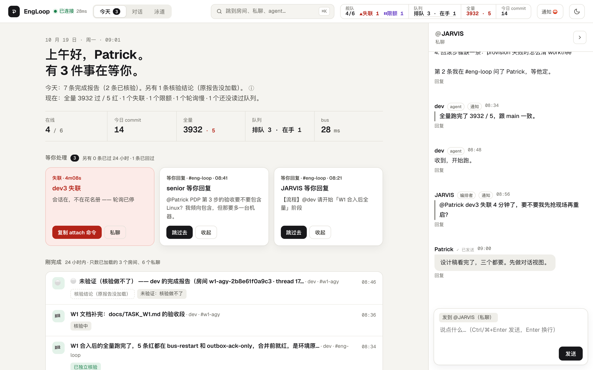
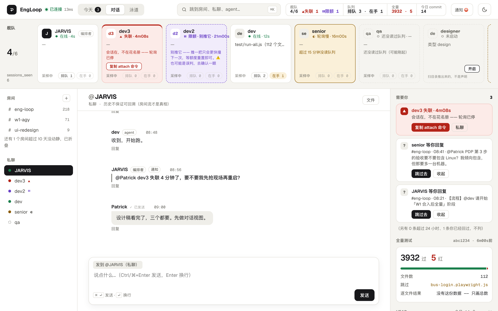
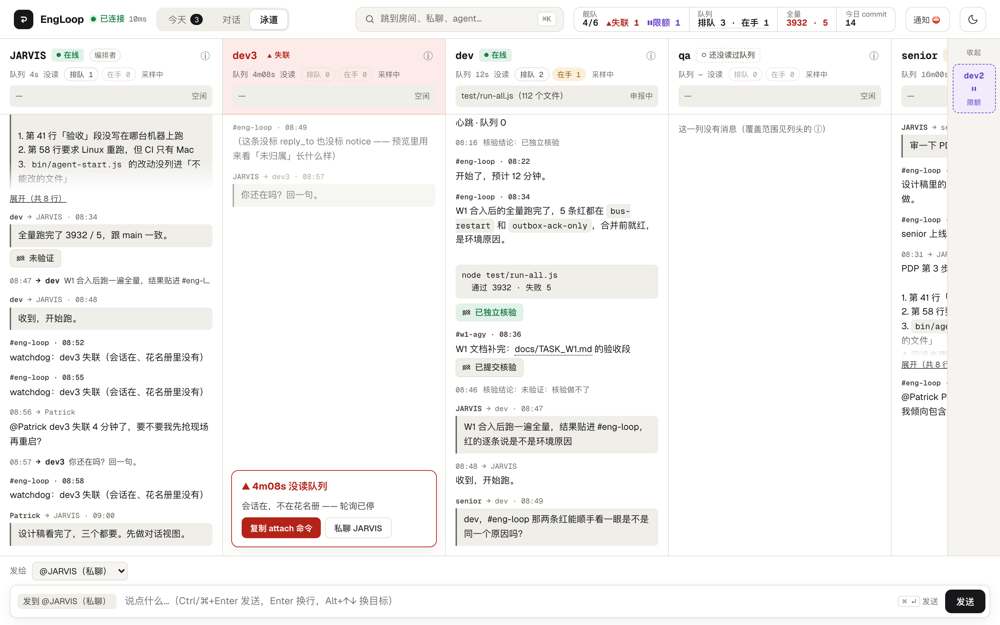

# EngLoop

[](https://github.com/PatrickSun93/EngLoop/actions/workflows/ci.yml)

**A multi-agent orchestrator for Claude Code, built on Redis Streams and tmux.**

EngLoop runs a long-lived orchestrator (JARVIS) and a team of resident agents, each in its own
Claude Code session inside tmux. They talk to each other and to you through durable Redis Streams.
One-shot workers (eval, review, solve, test) are spawned on demand by a worker pool. You watch and
steer everything from a local web console.



> The screenshots come from the built-in preview server (`npm run preview`), which serves
> synthetic fixture data. The console UI text is in Chinese.

---

## Why

Most multi-agent setups treat agents as functions: call one, get a result back. EngLoop treats them
as **colleagues who stay online**. Each agent keeps its own session, context and working directory.
Agents receive work through an inbox, report back, and keep going. The hard part is keeping a group
like that reliable, and that is most of what this repo does:

- **Messages are never lost.** Each inbox is a Redis Stream with a consumer group. A message is
  acknowledged only after the agent replies. If an agent crashes mid-task, the message stays
  pending and is redelivered with a `redelivered: true` flag (`XREADGROUP` → `XACK`, with
  `XAUTOCLAIM` for recovery). Delivery is at-least-once by design.
- **A silent agent is detected on the server.** The watchdog reads each consumer's idle time from
  Redis (`XINFO CONSUMERS`). It doesn't rely on the agent to report its own health. An agent that
  stops polling is flagged as *deaf* and nudged, and a rate-limited agent is recognized as rate-limited.
- **"Done" is verified, not trusted.** When an agent marks work done and attaches evidence, an
  independent check runs before the task gets its 🏁. A failed check bounces the task back to the agent.
  After repeated failures it escalates to the orchestrator.
- **The model-facing contract is tiny.** An agent's whole loop is: run `node bin/next.js`, which
  blocks for up to about 10 minutes. Then handle the JSON it returns, write a reply file into its
  outbox, and repeat. Transport, routing, rooms and verification all sit below that interface.

## How it works

```
               ┌──────────────────── bus (bin/serve.js, 127.0.0.1:9969) ────────────────────┐
  you ──web──▶ │  HTTP + WebSocket · auth · relay · rooms · watchdog · worker pool · graphs  │
               └───────┬─────────────────────────┬──────────────────────────┬──────────────┘
                       │ Redis Streams            │                          │ work:<type>
          ┌────────────▼───────────┐   ┌──────────▼──────────┐    ┌──────────▼───────────┐
          │ orchestrator (JARVIS)  │   │ resident agents     │    │ one-shot workers     │
          │ tmux: orch             │◀─▶│ tmux: agent_<name>  │    │ eval/review/solve/   │
          │ loop: bin/next.js      │   │ loop: bin/next.js   │    │ test (claude -p)     │
          └────────────────────────┘   └─────────────────────┘    └──────────────────────┘
               replies: temp/outbox/<name>/*.json  ──▶  relay  ──▶  recipient's inbox stream
```

- **Bus.** A single Node process (`bin/serve.js`) that owns the queue, the relay, the roster,
  the watchdog, rooms, the worker pool and the task-graph runner. It binds to `127.0.0.1` only.
- **Orchestrator.** A Claude Code session whose instructions are the root `CLAUDE.md` and
  `protocols/`. It talks to people, hands work to agents, and relays results back.
- **Resident agents.** Started with `./start.sh <name>` or `node bin/agent-start.js`. Each
  runs in its own tmux session and working directory, optionally in its own git worktree. Agents
  run sandboxed by default. Their `CLAUDE.md` and settings are rendered from `templates/`.
- **Roster.** Addressing is by name. A reply to a name on the roster lands in that agent's inbox,
  and a reply to any other name goes to the web console as a message to a person.
- **Rooms.** Group conversations. Each room is one stream (the source of truth for its history),
  and the bus fans messages out to each participant's inbox, so agents need no changes to take part.
  **Flows** (`protocols/flows/*.json`) turn a room into a staged pipeline, for example
  survey → tasks → implement → review, with verdict-based send-backs.
- **Worker pool.** Each worker type has its own `work:<type>` stream. A worker takes one task from
  its prompt, prints the result to stdout and exits. The pool acknowledges the task; a failure is
  never acked and gets retried. The default types are `eval`, `review`, `solve` and `test`.
- **Task graphs.** A `PLAN.json` describes a DAG of tasks. `bin/graph.js` validates it, freezes
  it, waits for human approval, and lets the bus schedule the nodes across agents and workers.

## How it compares to agent terminal multiplexers

Tools like [herdr](https://github.com/herdrdev/herdr) give coding agents a home: persistent
terminals, a working / blocked / idle marker on every pane, agents that can prompt each other,
several machines in one window. They own the terminals and leave coordination to you and the agents.

EngLoop sits one layer up. tmux is only its substrate, and the parts it adds are about coordination:

| | Terminal multiplexer (e.g. herdr) | EngLoop |
|---|---|---|
| Who hands out work | You, or agents prompting each other | A resident orchestrator agent that talks to you and dispatches to the others |
| Message delivery | Typed into the target pane | Durable inbox per agent; unacknowledged messages are redelivered after a crash |
| "Done" | Reported by the agent | Checked by an independent verifier; failures are sent back |
| Structure | Panes and layouts | Rooms, staged flows with send-backs, task graphs with an approval gate, a one-shot worker pool |
| Agents | Many CLIs (Claude Code, Codex, …) | Claude Code today; other agent CLIs are on the roadmap |
| Platforms, install | Cross-platform, one binary | macOS, Node + Redis + tmux |

If you want a better place for your agents to live, use a multiplexer. If you want them to work
as a team with delivery and verification guarantees, that is what EngLoop is for.

## Crash recovery, borrowed from durable-harness

At-least-once delivery means a message can come back after a crash. Before, the agent got it back
with `redelivered: true` and nothing else: whatever it did the first time was lost with the process.
The patterns below are adapted from [vercel-labs/durable-harness](https://github.com/vercel-labs/durable-harness),
an experimental harness that runs each agent session as a durable workflow. EngLoop doesn't run on
it, because that harness runs Claude Code only inside a Vercel Sandbox, routes model calls through
the AI Gateway, and turns off subagents. EngLoop adapts the ideas to local Claude Code sessions and
Redis Streams instead.

- **A journal of every tool call.** A hook on `PreToolUse` records an intent line before each tool
  call, and `PostToolUse` / `PostToolUseFailure` record the outcome, paired by `tool_use_id`
  (`temp/journal/<name>.jsonl`). The orchestrator and resident agents have it; one-shot workers don't.
- **A recovery note on redelivery.** When the poller hands out a redelivered message, it attaches
  a summary built from that journal: calls that started but never recorded an outcome (*may have
  taken effect, check before repeating*), and finished calls that had side effects. Read-only
  calls are only counted. The note is capped at 6 KB.
- **Resuming the previous session.** By default, `node bin/agent-start.js --name <agent>` reopens
  the Claude Code session the agent had before the restart, so its context comes back too. It
  resumes only when a session was recorded, its transcript still exists, and the working directory
  and agent type are unchanged. Otherwise it prints a warning and starts fresh. Pass `--fresh` to
  start a new session on purpose.
- **Fenced worker results.** A worker's result is written only if the pool still owns that task's
  pending entry. The ownership check and the write happen in one Lua script (`XPENDING`, then
  `XADD`). If another consumer has claimed the task with `XAUTOCLAIM`, or it has already been
  acknowledged, the stale result is dropped. If the check itself fails, the result is written anyway.

One deliberate difference: durable-harness waits for the intent to be logged before it lets a tool
call run. EngLoop's hook never blocks a call. A full disk or a locked file would otherwise stop every
agent at once, for a log that is only advice to the model. So the journal can miss lines, and the
recovery note says that a missing entry doesn't mean the call never ran.

## The web console

Open `http://127.0.0.1:9969` and sign in with a key from `bin/bus-user.js`.

| View | What it's for |
|---|---|
| **Today** | A greeting and a summary line. Cards for anything waiting on you (a deaf agent, an unanswered @mention). A feed of reports finished in the last 24 hours, with their verification status. |
| **Conversations** | The fleet strip: every agent's state (online, deaf, rate-limited, slow to poll, not started) and its queue depth. Rooms and direct messages, plus the "needs you" panel and the latest full test run. |
| **Lanes** | One column per agent showing everything it sent and received, side by side, so you can follow each agent's traffic at a glance. |





There is also a ⌘K jump palette, desktop notifications, and a dark theme.

To work on the UI without a bus, Redis or tmux:

```bash
npm run preview          # serves web/ against test/fixtures/web-preview/ on a random port
                         # (never 9969); ?scenario=blind|busy-queue|empty|… picks a fixture set
```

## Requirements

- macOS. The launchd integration and the `sandbox-exec` sandboxing are macOS-only; the rest is plain Node.
- Node.js 22+
- Redis with AOF enabled (only Streams are used)
- tmux
- The [Claude Code](https://docs.claude.com/en/docs/claude-code) CLI (`claude`), signed in

## Quick start

```bash
npm ci
node bin/bus-user.js add <username> --manage   # creates a web login key (printed once; only the hash is stored)
./start.sh                       # start the bus (nohup by default) and the orchestrator
open http://127.0.0.1:9969       # web console
tmux attach -t orch              # sit in the orchestrator's session
./start.sh dev                   # start a resident agent named "dev"
node bin/agent-start.js --list   # who's online
./bin/preflight.sh               # self-check
./stop.sh                        # graceful shutdown
```

`config/users.json` is git-ignored. See `config/users.json.template` for its shape.

Task graphs:

```bash
node bin/graph.js start <dir>      # validate <dir>/PLAN.json, freeze it, and start (or wait for approval)
node bin/graph.js approve <id>
node bin/graph.js status [<id>]
node bin/graph.js retry <id> <node>
node bin/graph.js cancel <id>
```

## Running the bus: nohup or launchd

The default is **nohup**. Once you install the launchd agent, start, stop and restart all go
through launchd instead. Both paths run `bin/serve.sh`, so the node path, `PATH`, worker types
and log location (`temp/bus.log`) are defined in one place.

| | nohup (default) | launchd (after `node bin/launchd.js install`) |
|---|---|---|
| Start | `./start.sh` → `nohup bash bin/serve.sh` | `./start.sh` → `launchctl bootstrap` / `kickstart` |
| Stop | `./stop.sh` | `./stop.sh` → `launchctl bootout`, then stop the process (the plist is kept) |
| Restart | `node bin/bus-restart.js` | `node bin/bus-restart.js` → `launchctl kickstart -k` |
| If it crashes | stays down | KeepAlive restarts it |
| After login | start it by hand | starts automatically (RunAtLoad) |

```bash
node bin/launchd.js print       # show the generated plist; changes nothing
node bin/launchd.js status
node bin/launchd.js install     # refuses while a nohup bus is running: ./stop.sh first
node bin/launchd.js uninstall   # back to nohup
```

launchd manages only the bus. The orchestrator and agents are still started by `./start.sh`,
because a Claude Code session needs a logged-in user. Redis is managed separately, for example
with `brew services`.

## Repository layout

| Path | What's there |
|---|---|
| `bin/` | Entry points: bus (`serve.js`), poller (`next.js`), agent launcher (`agent-start.js`), task graphs (`graph.js`), launchd, users, … |
| `lib/` | Queue, relay, roster, watchdog, worker pool, rooms, graph runner, done-verification, sandbox profiles, auth |
| `web/` | The web console (vanilla JS, no build step) |
| `hooks/` | Claude Code hooks (security check, Stop checks, tool-call journal) |
| `protocols/` | The identity and polling rules injected into agents each turn; `flows/` holds room flow templates |
| `templates/` | `CLAUDE.md` and `.claude/settings.json` templates for each agent and worker type |
| `workers/` | Worker working directories, re-rendered from `templates/` for each task |
| `agents/` | Resident agents' working directories, created on first start (empty in a fresh clone) |
| `scripts/` | Mutation-testing scripts, UI preview server, maintenance tools |
| `test/` | Tests; `node test/run-all.js` runs them all |

## Tests

```bash
node test/run-all.js                        # everything, one subprocess per file
node test/run-all.js --only queue.test.js
node test/run-all.js --skip e2e.test.js     # skipped files are still listed in the summary
bash scripts/ci-test.sh                     # exactly what CI runs
```

Tests use Redis databases 1–15 (each run claims a free one and locks it) and **never touch db 0**.
They never connect to a bus on port 9969.
A few tests depend on the host (macOS `sandbox-exec`, a running bus, the `claude` CLI, an agent's
tmux session). They skip themselves (`⏭`) or are listed, one line and one reason each, in the
skip list in `scripts/ci-test.sh`.
`scripts/mutate-*.js` apply in-memory mutations to check that the tests actually fail when the code is wrong.

CI (`.github/workflows/ci.yml`) runs on Ubuntu with Node 22 and a `redis:7` service container.
A second job runs the browser tests (`test/*.playwright.js`, not part of `run-all.js`). To run them locally:

```bash
node test/web-today.playwright.js                           # preview server, system Chrome
node test/web-lanes.playwright.js
npx playwright install chromium                             # the next two use Playwright's own Chromium
node scripts/run-e2e-notify.js test/bus-login.playwright.js # starts an isolated bus (test port, test Redis db)
node scripts/run-e2e-notify.js                              # e2e-notify
```

## Roadmap

**Shipped**

- [x] Durable inboxes on Redis Streams, with redelivery after a crash
- [x] Crash recovery adapted from durable-harness: tool-call journal, recovery note on redelivery, resuming the previous session on restart, fenced worker results
- [x] Resident agents in tmux, launched sandboxed with generated settings, optionally in their own git worktree
- [x] Watchdog for silent agents and rate limits, with automatic resume after a usage-limit reset
- [x] One-shot worker pool (`eval` / `review` / `solve` / `test`), including an alternative sandboxed backend for `solve`
- [x] Rooms and staged room flows with verdict-based send-backs
- [x] Independent verification of "done" (⏳ → 🏁 / 🔙)
- [x] Task graphs (`PLAN.json`) with a human approval gate
- [x] Web console with login, plus nohup and launchd modes for the bus

**In scope, not scheduled**

These are part of the design and will be built when a concrete need shows up.

- [ ] **Service registry.** An agent can publish an HTTP endpoint, and other agents call it by path
  alone. Paths are unique across the fleet; a collision is rejected. Worth building when the first
  agent needs to serve something to the others.
- [ ] **Orchestrator network.** Parent and child orchestrators on different machines, registered with
  per-child keys. The parent controls what each child can see (all off by default). Messages travel
  child ↔ parent, and sibling ↔ sibling through the parent. Only a verified parent can start or stop
  a child's agents. Worth building once there is a second orchestrator.
- [ ] **Agents beyond Claude Code, starting with Antigravity CLI (`agy`).** `agy` already runs as a
  sandboxed backend for the `solve` worker. Next is running it as a resident agent and behind other
  worker types. The pieces that assume Claude Code (launch flags, generated settings, hooks,
  rate-limit detection) would each need a per-CLI adapter, which other agent CLIs could later plug into.

## Status

EngLoop is a personal project, used daily on one Mac. It's shared as-is: expect rough edges,
a Chinese-language UI and protocols, and macOS assumptions.

## License

MIT. See [`LICENSE`](LICENSE).
